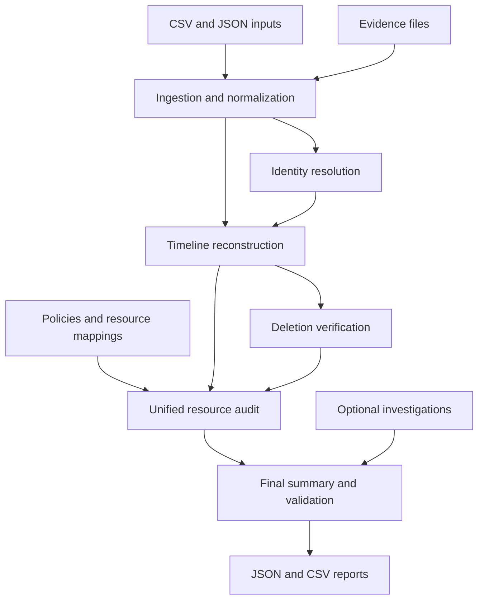

# GDPR Deletion Audit Agent

A Python-based audit-support tool that analyzes personal-data deletion requests against identity records, system activity, evidence, and configured retention policies.

## Features

- Validates and ingests CSV and JSON inputs.
- Resolves deletion-request identities and flags unmatched or ambiguous identities.
- Preserves request metadata, summarizes source-reported statuses, and flags
  non-deletion or unclear request text for manual review.
- Reconstructs event timelines and identifies potentially risky post-deletion activity.
- Evaluates deletion evidence and configured data-retention rules.
- Produces unified audit results and JSON/CSV reports.
- Runs automated tests with pytest.

## Project Structure

- `src/deletion_audit/` — application modules and audit pipeline.
- `tests/` — automated tests.
- `data/input/` — sample input files.
- `data/evidence/` — sample evidence files.
- `dashboard.py` — dashboard entry point.
- `requirements.txt` — pinned Python dependencies.
- `reports/` — generated reports; excluded from Git.

## Architecture



The deterministic audit pipeline makes resource-level decisions from mapped
resources, policy decisions, and timestamped event evidence. Timeline integrity
findings are also retained at the full-ingested-activity scope; they are not
restricted to resources in `resource_mapping.csv`.

## Requirements

- Python 3.10 or newer (the pinned NumPy dependency requires Python 3.10+).
- PowerShell on Windows (commands below use PowerShell syntax).

## Setup

From the project root:

```powershell
py -m venv .venv
.\.venv\Scripts\Activate.ps1
python -m pip install --upgrade pip
python -m pip install -r requirements.txt
```

If PowerShell blocks virtual-environment activation, you can run the venv's Python directly instead:

```powershell
.\.venv\Scripts\python.exe -m pip install -r requirements.txt
```

## Run the Audit Agent

```powershell
python -m src.deletion_audit.main
```

The application reads the configured sample inputs and writes audit reports under `reports/`.
The final JSON summary is `reports/final_gdpr_deletion_audit_summary.json`.

To review another request dataset, place it at `data/input/deletion_requests.csv`
with at least `case_id` and `email` columns, and provide a matching
`data/input/user_identities.csv` containing `user_id` and `email`. The pipeline
preserves any extra request columns. Keep a backup of the sample inputs before
replacing them; identity matching and request-text intent review are separate
from resource-level deletion verification.

## Interpreting the Final Report

`resources` contains only the resources evaluated from `resource_mapping.csv`.
By contrast, top-level `integrity_findings` covers relevant findings from all
ingested activity, including event records found in JSON and evidence files.
Consequently, a finding may name a resource (for example, `rec103`) that does
not appear in `resources`; this is expected and does not mean that resource was
evaluated. Check the finding's resource ID and the evaluated resource list
separately.

For example, the supplied sample evidence contains a DELETE followed by a
RESTORE for `rec103`, while `rec103` is not in the resource mapping. Its
post-deletion restore can therefore appear in top-level `integrity_findings`
without adding a resource-level audit result for `rec103`.

The report may include email addresses and internal identifiers in the
identity-resolution results and CSV export. Treat generated reports as
sensitive data: use synthetic records for demonstrations, restrict access to
the `reports/` directory, and do not commit real reports.

Deletion request `request_text` is classified conservatively for common
English, Spanish, Portuguese, French, Japanese, and Korean deletion phrases.
Explicit non-deletion requests are flagged for review. This phrase-based
classification is not a substitute for multilingual human review, and request
`reported_status` remains source-provided context rather than proof of deletion.

## Run Tests

```powershell
python -m pytest -q
```

## Run the Dashboard

```powershell
python -m streamlit run dashboard.py
```

If Streamlit is not installed, check the dashboard imports and add its verified dependency to `requirements.txt` before running this command.

## Important Limitations

This is an audit-support prototype. Its results depend on the completeness and accuracy of supplied records, evidence, identity mappings, and policy rules. A `VERIFIED` result is based on implemented checks; it is not by itself a legal determination or proof of compliance with every GDPR obligation.

An invalid timestamp associated with an evaluated resource prevents a
`VERIFIED_DELETED` result until the chronology can be established. Missing or
incomplete source records, unlinked evidence, incorrect resource mappings, and
unreliable verification methods can still limit what the audit can conclude.
Review global integrity findings as well as the resource-level results.

Use synthetic data for demos. Do not commit real personal data, credentials, API keys, or `.env` files.
